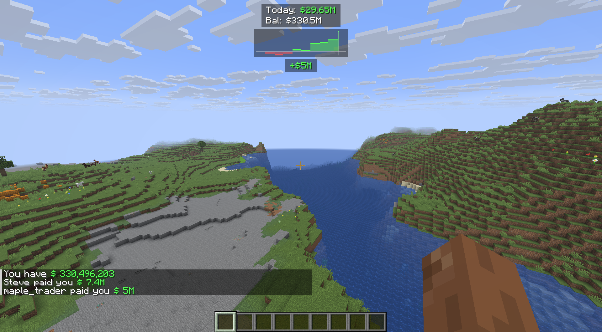
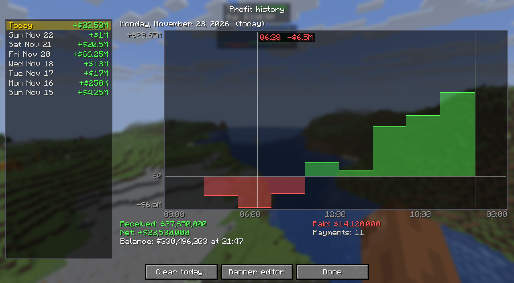
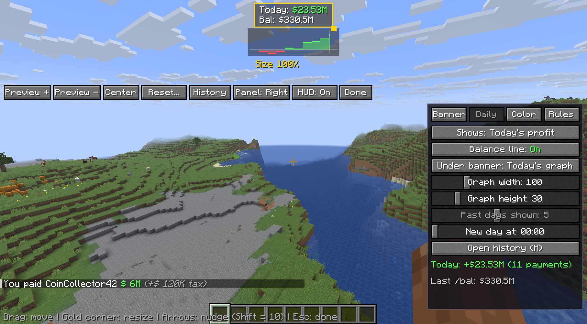
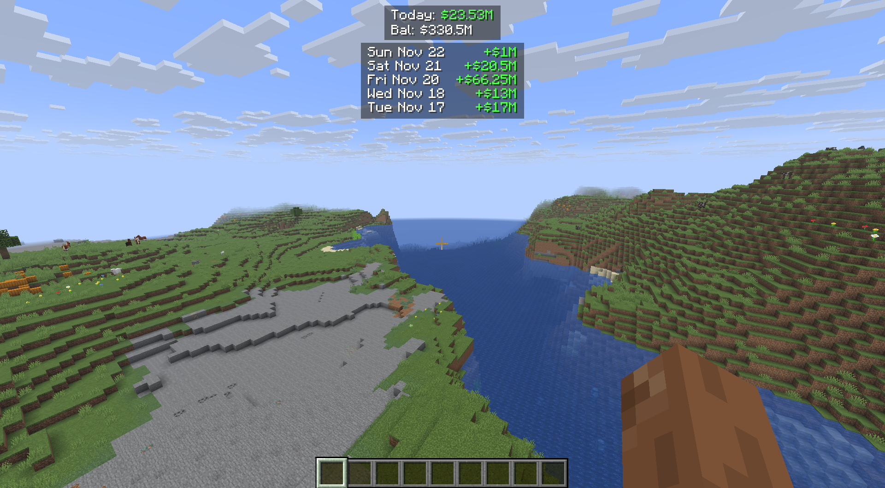
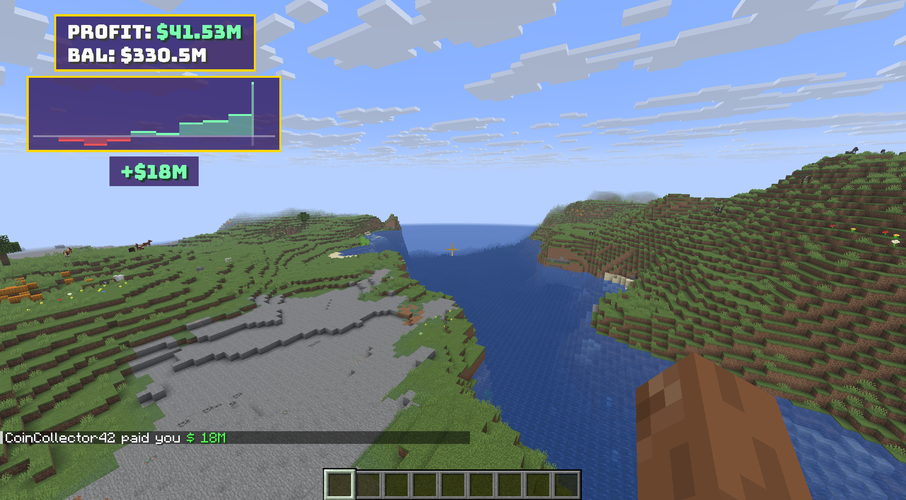
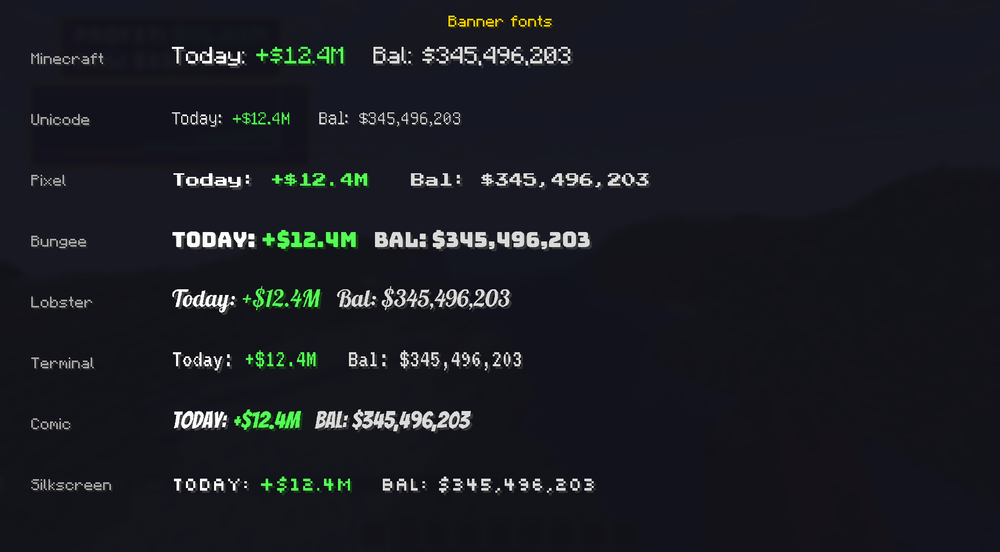

# Donut Profit HUD

> **Branch `mc/26.3`**: this branch builds the **Minecraft 26.3** jar (JDK 25). The 1.21.11 version is on `main`.

Client-side Fabric mod for Minecraft Java **1.21.11** and **26.3**. It shows a small banner (top centre by default) with
your **profit for today = received − paid** from confirmed DonutSMP player payments, briefly flashes each payment
(`+$3M` green / `-$3M` red), draws a graph of your profit through the day and keeps a history of every day. Type `/bal`
and it also shows your balance.

It only *reads* the payment confirmations the server already sends you. It never sends chat or commands, never clicks
anything and never makes payments. No API key, no server plugin.



| History (H) | Editor: Daily tab (K) | Past days under the banner |
| --- | --- | --- |
|  |  |  |

| Custom style | Fonts |
| --- | --- |
|  |  |

## Install

1. Install **Fabric Loader 0.20.1** (or newer) for **Minecraft 1.21.11** or **26.3**.
2. Put **Fabric API** for the same version in your `mods` folder (e.g. `fabric-api-0.141.6+1.21.11.jar` or
   `fabric-api-0.167.0+26.3.jar`).
3. Drop the matching jar into the same `mods` folder: `donut-profit-hud-1.1.0+1.21.11.jar` or
   `donut-profit-hud-1.1.0+26.3.jar`.

## Controls

| Key | Action |
| --- | --- |
| `J` | Show / hide the banner |
| `K` | Open the editor |
| `H` | Open the history |

All three can be rebound under Options → Controls → Key Binds → *Donut Profit HUD*.

### Editor (K)

Works like the Textboxes editor: the world stays visible and the banner is edited in place.

* **Drag** the banner to move it; **drag the gold corner** to resize it; arrow keys nudge (Shift = 10 px).
* Toolbar: *Preview +* / *Preview −* (test flash, nothing is counted), *Center*, **Reset…** (asks for confirmation,
  then clears today's payments and graph, or the session total in Session mode), *History*, *Panel: Right/Left/Off*,
  *HUD: On/Off*, *Done*.
* **Banner** tab: label text, size, center / snap to top, font (8 to choose from), bold, italic, border width, text
  shadow, flash on/off, flash time.
* **Daily** tab: *Shows* today's profit (resets every day) or the session total; balance line on/off; what goes under
  the banner (today's graph, past days or nothing); graph width/height; how many past days; the hour a new day starts.
* **Color** tab: pick what to edit (positive net, negative net, zero net, label, background, border), then use the
  Red/Green/Blue sliders, Opacity (background and border), a hex field or the 16 swatches.
* **Rules** tab: *Count tax as paid*, *DonutSMP only*, *Count away pay*, plus the session's received / paid / count.

### History (H)

Every day you were paid or paid someone, newest first. Pick a day to see its profit graph from the start to the end of
the day (hover to read your profit at any time), received, paid, net, number of payments and your balance. *Delete
day…* removes a day after a confirmation. About a year of days is kept.

### Balance

When you type `/bal`, DonutSMP answers `You have $ 330,496,203`. The mod reads that reply (it never sends `/bal`
itself), shows it on the banner's second line and stores the first and last reading of each day. Your balance also
changes from shops, auctions and orders, so the history shows it next to your payment profit rather than mixing them.

## What counts

Only these exact DonutSMP system messages (formats taken from real logs/screenshots):

| Message | Effect |
| --- | --- |
| `<player> paid you $ 7.4M` | +7,400,000 received |
| `You paid <player> $ 6M (+$ 120K tax)` | 6,120,000 paid (tax included; toggle *Count tax as paid* to count only 6M) |
| `You were paid $ 4.8M while you were away` | +4,800,000 received (join summary; toggle *Count away pay*) |

Not counted: failed payments (e.g. "That player does not have payments enabled in /settings", "This user is not
online"), your typed `/pay` commands, other players' transfers ("X was paid $ … by Y", "X paid Y $ …"), shop / auction
lines, action-bar messages, and any player chat. DonutSMP
delivers player chat as system messages too, so the whole message must match exactly: a player typing
"x paid you $ 5M" always arrives with their own `<name>` / `name:` prefix and is ignored. Payments only count while
connected to a server whose address contains `donutsmp` (toggle *DonutSMP only*).

Amounts are kept exactly (`BigDecimal`). DonutSMP itself prints compact amounts ("$ 7.4M"), so that printed value is
the most precise number the client ever gets.

## Files

* `config/donutprofithud.json`: settings
* `config/donutprofithud-history.json`: daily history (totals, graph points, /bal readings)
* `config/donutprofithud-session.properties`: session total for Session mode (kept until you reset it)

## Fonts

Pixel (Press Start 2P), Bungee, Lobster, Terminal (VT323), Comic (Bangers) and Silkscreen are bundled under the SIL Open
Font License 1.1; the licence texts are in `src/main/resources/licenses/fonts/`. Minecraft and Unicode are the game's own fonts.

## Build from source

This folder builds the **1.21.11** jar. It requires a JDK 21 (`JAVA_HOME`) and uses Loom 1.17.21 (the newest Loom line
that runs on Java 21) with official Mojang mappings, Fabric Loader 0.20.1, Fabric API 0.141.6+1.21.11 and the Gradle
9.8.2 wrapper from the Fabric example mod.

The **26.3** port lives in its own copy of the project. It needs a JDK 25 and uses the `net.fabricmc.fabric-loom`
plugin (1.19-SNAPSHOT, as in the Fabric example mod), no mappings (26.x is unobfuscated) and Fabric API
0.167.0+26.3. Its code differs only where 26.3 renamed the API (`GuiGraphicsExtractor`, `extractRenderState`,
`minecraft.gui.setScreen`, `KeyMappingHelper`, key events instead of GLFW codes).

```
gradlew.bat build
```

The installable jar is `build/libs/donut-profit-hud-1.1.0+1.21.11.jar` (or `+26.3`); tests are in `src/test/java`.

### Screenshots

`gradlew.bat runDemo` starts a dev client with a small helper mod (`src/demo`, never packed into the release jar). It
creates a creative test world, fills a made-up history, feeds simulated payment and /bal messages through the same parser, opens the editor and history and saves
the shots in `run-demo/screenshots/`, then quits. Store-page texts and images are in `listing/`.

*Not affiliated with DonutSMP or Mojang.*
