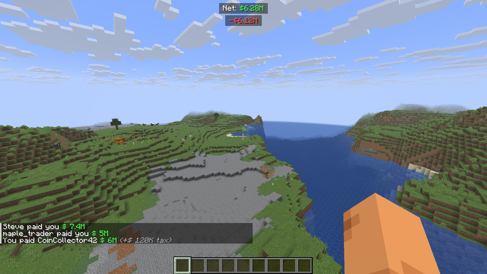
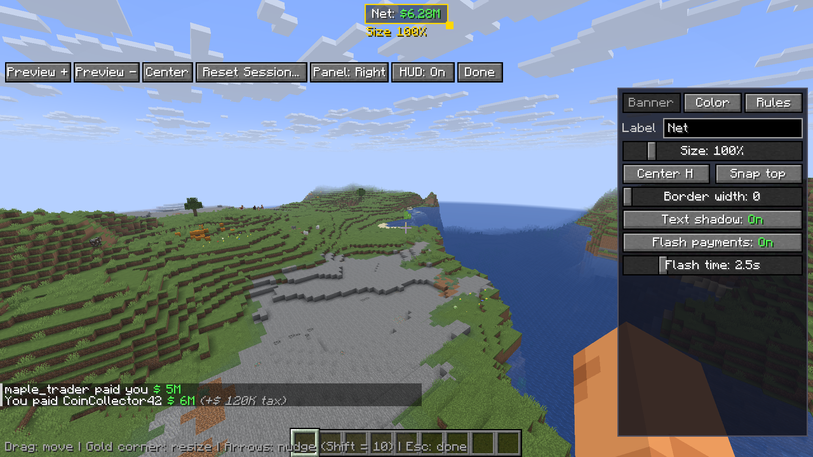
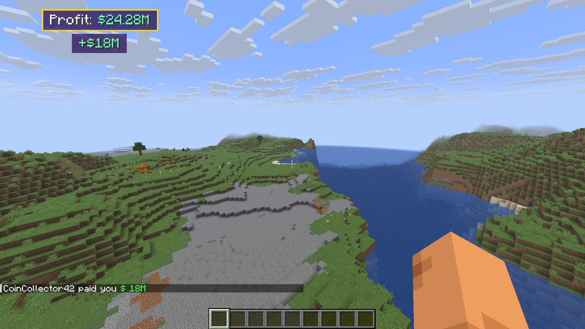

# Donut Profit HUD

Client-side Fabric mod for Minecraft Java **1.21.11**. It shows a small banner (top centre by default) with your running
**net = total received − total paid** from confirmed DonutSMP player payments, and briefly flashes each payment
(`+$3M` green / `-$3M` red).

It only *reads* the payment confirmations the server already sends you. It never sends chat or commands, never clicks
anything and never makes payments. No API key, no server plugin.


| Paying someone | Editor (K) | Custom style |
| --- | --- | --- |
|  |  |  |

## Install

1. Install **Fabric Loader 0.20.1** (or newer) for **Minecraft 1.21.11**.
2. Put **Fabric API** for 1.21.11 (e.g. `fabric-api-0.141.6+1.21.11.jar`) in your `mods` folder.
3. Drop `donut-profit-hud-1.0.0.jar` into the same `mods` folder (`.minecraft/mods/`, or your launcher
   instance's `mods` folder).

## Controls

| Key | Action |
| --- | --- |
| `J` | Show / hide the banner |
| `K` | Open the editor |

Both can be rebound under Options → Controls → Key Binds → *Donut Profit HUD*.

### Editor (K)

Works like the Textboxes editor: the world stays visible and the banner is edited in place.

* **Drag** the banner to move it; **drag the gold corner** to resize it; arrow keys nudge (Shift = 10 px).
* Toolbar: *Preview +* / *Preview −* (test flash, nothing is counted), *Center*, **Reset Session…** (asks for
  confirmation, then sets received, paid, net and the payment count back to 0), *Panel: Right/Left/Off*, *HUD: On/Off*, *Done*.
* **Banner** tab: label text, size, center / snap to top, border width, text shadow, flash on/off, flash time.
* **Color** tab: pick what to edit (positive net, negative net, zero net, label, background, border), then use the
  Red/Green/Blue sliders, Opacity (background and border), a hex field or the 16 swatches.
* **Rules** tab: *Count tax as paid*, *DonutSMP only*, *Count away pay*, plus received / paid / payment count.

## What counts

Only these exact DonutSMP system messages (formats taken from real logs/screenshots):

| Message | Effect |
| --- | --- |
| `<player> paid you $ 7.4M` | +7,400,000 received |
| `You paid <player> $ 6M (+$ 120K tax)` | 6,120,000 paid (tax included; toggle *Count tax as paid* to count only 6M) |
| `You were paid $ 4.8M while you were away` | +4,800,000 received (join summary; toggle *Count away pay*) |

Not counted: failed payments (e.g. "That player does not have payments enabled in /settings", "This user is not
online"), your typed `/pay` commands, other players' transfers ("X was paid $ … by Y", "X paid Y $ …"), shop / auction
lines, action-bar messages, and any player chat. DonutSMP
delivers player chat as system messages too, so the whole message must match exactly: a player typing
"x paid you $ 5M" always arrives with their own `<name>` / `name:` prefix and is ignored. Payments only count while
connected to a server whose address contains `donutsmp` (toggle *DonutSMP only*).

Amounts are kept exactly (`BigDecimal`). DonutSMP itself prints compact amounts ("$ 7.4M"), so that printed value is
the most precise number the client ever gets.

## Files

* `config/donutprofithud.json`: settings
* `config/donutprofithud-session.properties`: session totals (kept across reconnects/restarts until you press Reset Session)

## Build from source

Requires a JDK 21 (`JAVA_HOME`). Uses Loom 1.17.21 (the newest Loom line that runs on Java 21) with official Mojang
mappings, Fabric Loader 0.20.1, Fabric API 0.141.6+1.21.11 and the Gradle 9.8.2 wrapper from the Fabric example mod.

```
gradlew.bat build
```

The installable jar is `build/libs/donut-profit-hud-1.0.0.jar`; tests are in `src/test/java`.

### Screenshots

`gradlew.bat runDemo` starts a dev client with a small helper mod (`src/demo`, never packed into the release jar). It
creates a creative test world, feeds simulated payment messages through the same parser, opens the editor and saves
the shots in `run-demo/screenshots/`, then quits. Store-page texts and images are in `listing/`.

*Not affiliated with DonutSMP or Mojang.*
